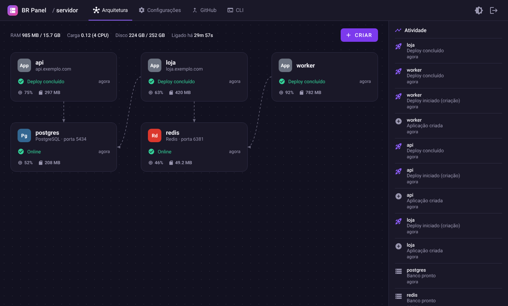
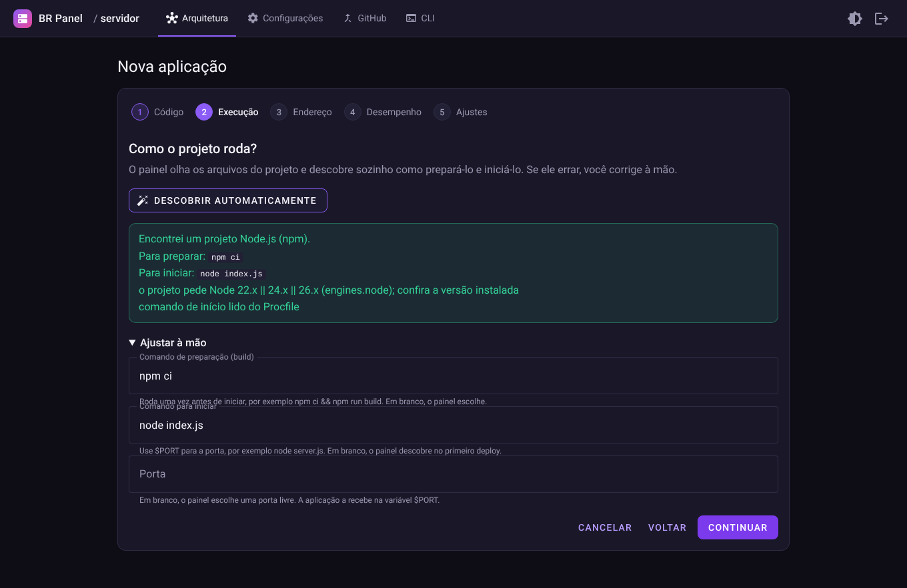
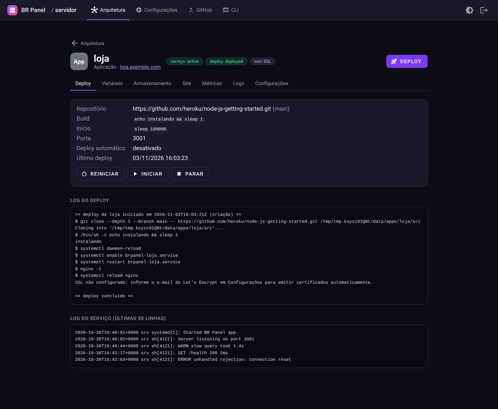
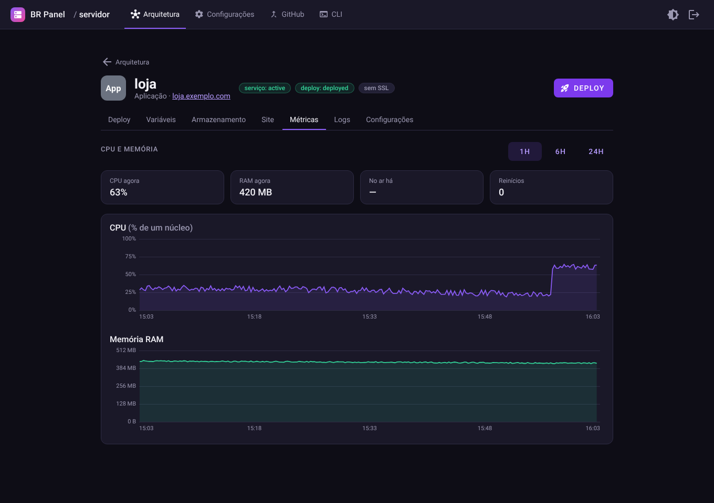
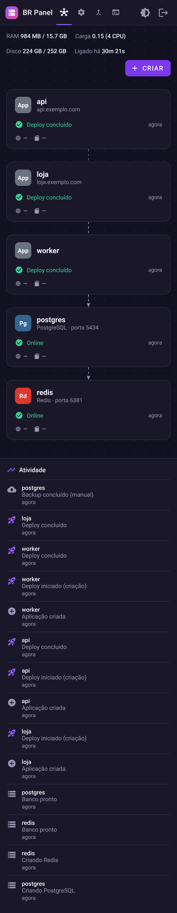

# BR Panel

O BR Panel é um painel para colocar o seu site ou sistema na internet sem precisar decorar comandos. Você aponta para o código do projeto, clica em publicar, e ele fica no ar, com endereço próprio e cadeado de segurança. Depois, quando você atualiza o código, o site se atualiza sozinho.

Ele foi pensado para quem tem um servidor (uma VPS) e quer cuidar dele sem virar especialista. Tudo acontece numa tela web, em português.



## O que você consegue fazer

- Publicar um projeto a partir do GitHub, sem preencher formulário comprido. O painel olha o projeto e descobre sozinho como ele funciona.
- Ter um endereço próprio (como `loja.seusite.com.br`) com cadeado de segurança, emitido e renovado sem você pedir.
- Atualizar o site a cada vez que você salva uma mudança no GitHub.
- Acompanhar quanto de processador e de memória cada projeto usa, em gráficos das últimas 24 horas.
- Instalar programas prontos, como n8n, Uptime Kuma e Gitea, com um clique.
- Criar bancos de dados (PostgreSQL, MySQL, MongoDB e Redis) e ligá-los aos seus projetos.
- Guardar arquivos importantes e fazer cópias de segurança, manuais ou agendadas.
- Aguentar mais visitantes: o painel liga várias cópias do projeto e reparte o movimento entre elas.
- Controlar tudo também pelo celular, pelo computador ou por uma ferramenta de inteligência artificial.

Cada item está explicado, com imagens, em [Funcionalidades](docs/funcionalidades.md).

## Como funciona na prática

1. Você instala o painel no servidor com um comando, uma vez só.
2. Abre o link que aparece e cria o seu usuário e a sua senha.
3. Escolhe o projeto do GitHub que quer publicar.
4. Clica em publicar e espera. O andamento aparece na tela.



## Como instalar

Você precisa de um servidor com Ubuntu ou Debian e acesso de administrador. Cole este comando no terminal do servidor:

```sh
curl -fsSL https://raw.githubusercontent.com/viniciusdev772/br_panel/main/scripts/install.sh | sudo sh
```

No final, ele mostra um link. Abra esse link no navegador, crie o seu usuário e pronto. Para atualizar o painel mais tarde, rode o mesmo comando de novo. Os seus projetos e dados ficam como estão.

Quer ler o comando antes de executar? Ele está em [`scripts/install.sh`](scripts/install.sh).

## Um painel para o dia a dia

Cada projeto tem a sua página, com o estado atual, o histórico de publicações, os gráficos de uso e os registros do que o sistema escreveu enquanto rodava. Se algo der errado, a mensagem diz o que aconteceu e o que fazer.





Dá para usar o painel no celular. As telas se ajustam ao tamanho da tela.



## Segurança

O acesso é protegido por usuário e senha, e o painel bloqueia quem erra a senha várias vezes seguidas. A senha fica guardada de um jeito que nem o próprio painel consegue ler. Dados sensíveis, como senhas de banco de dados, aparecem escondidos e só se mostram quando você pede. Para usar o painel pela internet, o ideal é abri-lo por um endereço com cadeado.

## Precisa de ajuda ou quer contribuir?

- Encontrou uma falha de segurança? Leia o [`SECURITY.md`](SECURITY.md) antes de contar a alguém.
- Dúvidas e ideias: abra uma conversa na aba Issues do GitHub.
- Quem programa e quer mexer no painel encontra tudo em [Documentação técnica](docs/README.md) e em [`CONTRIBUTING.md`](CONTRIBUTING.md).
