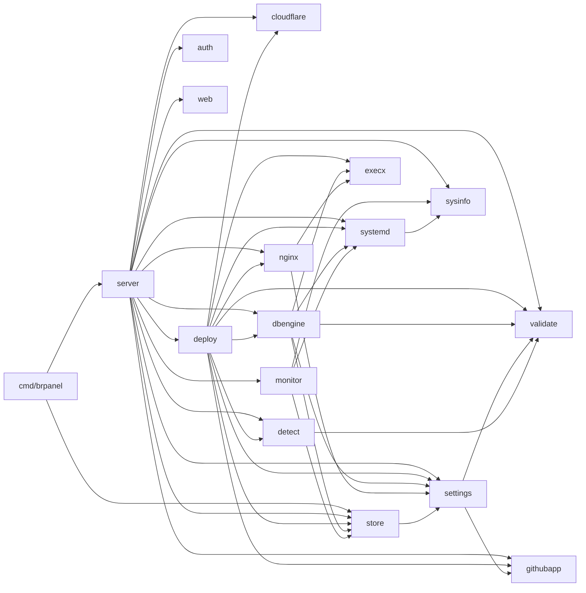

# Arquitetura

O BR Panel é um único binário Go (`cmd/brpanel`) que gerencia aplicações como **serviços systemd** (sem Docker). O estado fica em um banco SQLite; a interface é HTML renderizado no servidor com Material Design 2 (MDC Web 14).

## Pacotes

| Pacote | Responsabilidade |
|---|---|
| `cmd/brpanel` | Flags (`-addr`, `-data`), diretórios, abertura do banco, ciclo de vida |
| `internal/server` | Camada HTTP: rotas, templates, setup inicial, login, apps, monitoramento, webhook |
| `internal/deploy` | Pipeline de deploy: git → detecção → build → unit → Nginx/SSL; layout em disco; escolha de porta |
| `internal/detect` | Detecta Node, Go, Rust, Python, Ruby, PHP e estáticos; lê `Procfile` e `brpanel.json` |
| `internal/dbengine` | Bancos de dados: motores (Postgres, MySQL/MariaDB, MongoDB, Redis), provisionamento, backups, dados, referências `${{db.VAR}}` |
| `internal/nginx` | Vhosts reverse-proxy, `nginx -t` com rollback, certbot (webroot) |
| `internal/systemd` | Renderiza units; `systemctl`, `journalctl`; status do serviço |
| `internal/monitor` | Amostrador de CPU/RAM por cgroup v2 → SQLite |
| `internal/sysinfo` | Leitura de cgroup v2 e `/proc` (RAM, carga, disco, uptime) |
| `internal/cloudflare` | Registro DNS A do domínio da app via API Token da Cloudflare (só biblioteca padrão) |
| `internal/githubapp` | Assinatura de webhooks, JWT de App, token de instalação por repositório, criação do App pelo fluxo de manifest |
| `internal/settings` | Configuração guardada no banco, validação, Argon2id |
| `internal/store` | SQLite: apps, configurações, métricas; migrações |
| `internal/auth` | Sessões, CSRF, bloqueio por IP, `ClientIP`/`IsHTTPS` |
| `internal/validate` | Validadores de entrada (nome, repositório, branch, domínio, env…) |
| `internal/execx` | Execução de comandos do host com log |
| `web` | Templates e estáticos embutidos (`go:embed`) |

### Dependências permitidas



Pacotes de `internal/` nunca importam `server`. A regra completa está em `.claude/rules/architecture.md`.

## Fluxos

### Primeiro início
1. `server.New` carrega as configurações; sem hash de admin, `configured=false`.
2. `announceSetup` gera um token de uso único (log + `<data>/setup_token`).
3. O middleware `gate` redireciona tudo para `/setup`. O formulário exige o token, cria o admin e as configurações iniciais, apaga o token e abre a sessão.

### Deploy (`deploy.Deployer.Start`)
`BeginDeploy` (compare-and-set no SQLite) → `git clone/fetch --depth 1` (com token do GitHub App só para o git, se houver) → `autoConfigure` (apenas se o comando de início está vazio; grava build/start/porta detectados) → build via `sh -c` → env file + unit → `systemctl daemon-reload/enable/restart` → DNS na Cloudflare (se há token) → vhost Nginx e certificado (se há domínio) → `FinishDeploy`. Um push durante o deploy marca "pendente" e dispara mais um deploy ao final.

### Webhook do GitHub
`POST /webhooks/github` → confere `X-Hub-Signature-256` → evento `push` em `refs/heads/<branch>` → apps com deploy automático cujo repositório (sem diferenciar maiúsculas) e branch coincidem → `Deployer.Start`.

### Banco de dados (`dbengine.Manager`)
`Create` valida o nome (apps e bancos compartilham o namespace), exige o motor instalado, cria o usuário de serviço, escolhe uma
porta livre e grava o registro (`provisioning`); em segundo plano: diretórios → `initdb`/`mariadb-install-db` (como o usuário do
banco) → arquivos de configuração → unit `brpaneldb-<nome>.service` → `systemctl enable/restart` → espera a porta → cria banco e
usuário (`postStart`) → `ready`. Segredos nunca vão em argv (variáveis de ambiente `PGPASSWORD`/`MYSQL_PWD`/`REDISCLI_AUTH` ou arquivos 0600
temporários). Cada motor implementa a interface `engine` (`locate`, `init`, `configure`, `execStart`, `postStart`, `url`, `backup`,
`restore`, `setPassword`, `tables`, `preview`).

### Monitoramento
`monitor.Run` lê a cada 15 s `cpu.stat` e `memory.current` (menos `inactive_file`) de `/sys/fs/cgroup/system.slice/brpanel-<app>.service` e grava em `metrics` (24 h). A UI consulta `/apps/{name}/metrics` e `/api/overview`.

## Rotas HTTP

| Método e caminho | Autenticação | Descrição |
|---|---|---|
| `GET/POST /setup` | token de instalação (só antes de configurar) | Primeiro início |
| `GET/POST /login`, `POST /logout` | — / sessão+CSRF | Sessão |
| `GET /` | sessão | Dashboard |
| `GET /apps/new`, `POST /apps` | sessão (+CSRF no POST) | Criar aplicação |
| `POST /apps/detect` | sessão+CSRF | Detecção automática (clone temporário) |
| `GET /apps/{name}` | sessão | Detalhe, monitoramento |
| `GET/POST /apps/{name}/edit` | sessão (+CSRF) | Editar |
| `POST /apps/{name}/{deploy\|start\|stop\|restart\|delete}` | sessão+CSRF | Ações |
| `GET /apps/{name}/logs` | sessão | Página de logs |
| `GET /apps/{name}/log?kind=service\|deploy&lines=N&download=1` | sessão | Texto dos logs |
| `GET /apps/{name}/metrics?range=1h\|6h\|24h` | sessão | JSON de CPU/RAM e status |
| `GET /api/overview` | sessão | JSON do canvas (host, recursos, atividade) |
| `GET /databases/new`, `POST /databases`, `POST /databases/install` | sessão (+CSRF) | Criar/instalar banco |
| `GET /databases/{name}` | sessão | Página do banco (Conectar, Dados, Backups, Métricas, Logs, Configurações) |
| `GET /databases/{name}/{log\|metrics\|data}` | sessão | Logs, métricas e navegador de dados |
| `GET /databases/{name}/backups/{file}` | sessão | Download de backup (nome validado) |
| `POST /databases/{name}/{start\|stop\|restart\|backup\|restore\|backup-delete\|schedule\|regenerate\|public\|delete}` | sessão+CSRF | Ações |
| `POST /apps/{name}/env` | sessão+CSRF | Salvar variáveis (valida referências a bancos) |
| `GET/POST /settings` | sessão (+CSRF) | Configurações |
| `GET /github` | sessão | Criação guiada do GitHub App e guia manual |
| `POST /github/domain` | sessão + CSRF | Cria o registro DNS na Cloudflare, salva o domínio do painel e o publica |
| `GET /github/app/new` | sessão | Página que envia o manifest do App ao GitHub (CSP relaxada só aqui) |
| `GET /github/app/callback` | `state` de uso único | Retorno do GitHub: troca o `code` pelas credenciais do App e as salva |
| `POST /webhooks/github` | HMAC do GitHub | Eventos `ping` e `push` |
| `GET /static/*` | — | CSS/JS embutidos |

## Diretório de dados (`-data`, padrão `/var/lib/brpanel`)

```
brpanel.db (+ -wal, -shm)   banco SQLite, modo 0600
setup_token                 só até concluir o primeiro início
apps/<app>/src/             checkout do repositório
env/<app>.env               variáveis do serviço, modo 0600
logs/<app>.log              log do último deploy
logs/db-<nome>.log          provisionamento e backups de um banco
databases/<nome>/           data/ run/ backups/ (+ redis.conf, init.sql): dono = usuário dos bancos
tmp/                        clones temporários da detecção
```

Fora dele: `brpanel-<app>.service` (`unit_dir`), `brpanel-<app>.conf` e `00-brpanel-common.conf` (`nginx_dir`), certificados do Let's Encrypt.
