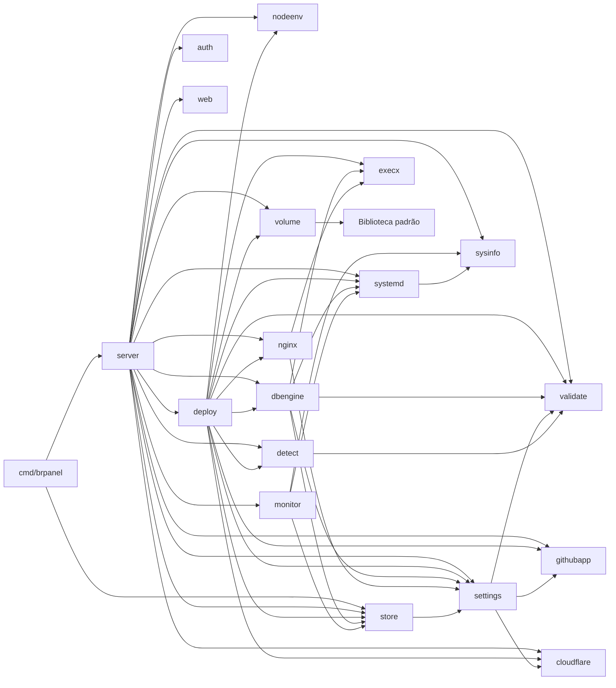

# Arquitetura

O BR Panel é um único binário Go (`cmd/brpanel`) que gerencia aplicações como **serviços systemd** (sem Docker). O estado fica em um banco SQLite; a interface é HTML renderizado no servidor com Material Design 2 (MDC Web 14).

## Pacotes

| Pacote | Responsabilidade |
|---|---|
| `cmd/brpanel` | Flags (`-addr`, `-data`), diretórios, abertura do banco, ciclo de vida |
| `internal/server` | Camada HTTP: rotas, templates, setup inicial, login, apps, monitoramento, webhook |
| `internal/deploy` | Pipeline de deploy: git → detecção → build → unit → Nginx/SSL; layout em disco; escolha de porta |
| `internal/detect` | Detecta Node, Go, Rust, Python, Ruby, PHP e estáticos; lê `Procfile` e `brpanel.json` |
| `internal/dbengine` | Bancos de dados: motores (Postgres, MySQL/MariaDB, MongoDB, Redis), provisionamento, backups, dados, referências `${{db.VAR}}` |
| `internal/volume` | Volumes das aplicações: `tar.gz` (criar e extrair) e arquivos de backup, sem programa externo |
| `internal/nginx` | Vhosts reverse-proxy, `nginx -t` com rollback, certbot (webroot) |
| `internal/systemd` | Renderiza units; `systemctl`, `journalctl`; status do serviço |
| `internal/monitor` | Amostrador de CPU/RAM por cgroup v2 → SQLite |
| `internal/sysinfo` | Leitura de cgroup v2 e `/proc` (RAM, carga, disco, uptime) |
| `internal/cloudflare` | Registro DNS A do domínio da app via API Token da Cloudflare (só biblioteca padrão) |
| `internal/nodeenv` | Instala o Node.js com o nvm (versão fixa) em `<data>/nvm` e liga node/npm/npx em `/usr/local/bin` |
| `internal/githubapp` | Assinatura de webhooks, JWT de App, token de instalação por repositório, criação do App pelo fluxo de manifest |
| `internal/settings` | Configuração guardada no banco, validação, Argon2id |
| `internal/store` | SQLite: apps, configurações, métricas; migrações |
| `internal/auth` | Sessões, CSRF, bloqueio por IP, `ClientIP`/`IsHTTPS` |
| `internal/validate` | Validadores de entrada (nome, repositório, branch, domínio, env…) |
| `internal/execx` | Execução de comandos do host com log |
| `web` | Templates e estáticos embutidos (`go:embed`) |

### Dependências permitidas



Pacotes de `internal/` nunca importam `server`. A regra completa está em `.claude/rules/architecture.md`.

## Fluxos

### Primeiro início
1. `server.New` carrega as configurações; sem hash de admin, `configured=false`.
2. `announceSetup` gera um token de uso único (log + `<data>/setup_token`).
3. O middleware `gate` redireciona tudo para `/setup`. O formulário exige o token, cria o admin e as configurações iniciais, apaga o token e abre a sessão.

### Deploy (`deploy.Deployer.Start`)
`BeginDeploy` (compare-and-set no SQLite) → `git clone/fetch --depth 1` (com token do GitHub App só para o git, se houver) → `autoConfigure` (apenas se o comando de início está vazio; grava build/start/porta detectados) → build via `sh -c` → env file + unit → `systemctl daemon-reload/enable/restart` → DNS na Cloudflare (se há token) → vhost Nginx e certificado (se há domínio) → `FinishDeploy`. Um push durante o deploy marca "pendente" e dispara mais um deploy ao final.

### Webhook do GitHub
`POST /webhooks/github` → confere `X-Hub-Signature-256` → evento `push` em `refs/heads/<branch>` → apps com deploy automático cujo repositório (sem diferenciar maiúsculas) e branch coincidem → `Deployer.Start`.

### Banco de dados (`dbengine.Manager`)
`Create` valida o nome (apps e bancos compartilham o namespace), exige o motor instalado, cria o usuário de serviço, escolhe uma
porta livre e grava o registro (`provisioning`); em segundo plano: diretórios → `initdb`/`mariadb-install-db` (como o usuário do
banco) → arquivos de configuração → unit `brpaneldb-<nome>.service` → `systemctl enable/restart` → espera a porta → cria banco e
usuário (`postStart`) → `ready`. Segredos nunca vão em argv (variáveis de ambiente `PGPASSWORD`/`MYSQL_PWD`/`REDISCLI_AUTH` ou arquivos 0600
temporários). Cada motor implementa a interface `engine` (`locate`, `init`, `configure`, `execStart`, `postStart`, `url`, `backup`,
`restore`, `setPassword`, `tables`, `preview`).

### Opções do Nginx por aplicação (`store.Web`, `nginx`, `deploy.ApplySite`)

A aba **Site** grava `store.Web` (JSON na coluna `apps.web`, separado do formulário da aplicação: `UpdateConfig` não o toca; `SetWeb` o salva). `siteFor` copia as opções para `nginx.Site`, e `renderVhost` gera um conjunto de blocos `server` por domínio (principal, extras e redirecionamentos), cada um com o próprio `ssl_certificate`; o grupo `upstream` e a zona de limite ficam uma vez só no topo. Domínios sem certificado servem em HTTP e `Ensure` emite os que faltam um a um (falha em um não impede os outros). Um redirecionamento aponta para `https` só quando o destino já tem certificado.

Senha: `server` ganha `auth_basic` com o arquivo `brpanel-<app>.htpasswd` (bcrypt `$2y$`, gerado por `nginx.HashPassword`); o local do desafio ACME tem `auth_basic off`. Manutenção: `error_page 503` para um local nomeado que serve `brpanel-<app>.maintenance.html` (título e texto escapados) e `location / { return 503; }`; com ela ligada a senha é dispensada. Os dois arquivos ficam ao lado do vhost e são regravados ou removidos junto com ele. `ApplySite` só recarrega o vhost (rápido) e, ao adicionar domínio, roda `Ensure` em segundo plano com o log na aba Logs; antes de salvar no banco o vhost novo passa por `nginx -t`, então uma configuração recusada nunca é guardada.

### Armazenamento das aplicações (`deploy.prepareMounts`)

Na aba **Armazenamento** da aplicação: o tipo `volume` é uma pasta gerenciada pelo painel em `<data>/volumes/<app>/<nome>` (dono: usuário das apps), `bind` aponta para uma pasta que já existe no servidor e `file` guarda um texto no banco e o grava em arquivo montado **somente leitura** (`<data>/files/<app>/<id>`, 0600). Tudo valida em `internal/validate` (nome; destino relativo ou absoluto; caminhos proibidos no destino e no `bind`: `/etc`, `/proc`, `/sys`, `/dev`, `/boot`, `/root`, `/run`, o diretório de dados e, no destino, `/usr` e outros).

Antes de escrever as units, `prepareMounts` valida as linhas de novo, cria as pastas de cada volume, grava os arquivos do tipo `file` e cria o destino de cada montagem (dentro do projeto quando relativo). Cada instância recebe as mesmas linhas `BindPaths=`/`BindReadOnlyPaths=` e a variável `VOLUME_<NOME>` com o caminho real; as instâncias compartilham a mesma pasta; `Scale` refaz a preparação antes de subir instâncias novas. Remover a montagem não apaga a pasta; excluir a aplicação apaga volumes, arquivos e backups, com confirmação na tela.

Backups de volume (mesmo padrão dos bancos): **agora** ou agenda (desligado/diário/semanal, goroutine `RunVolumeScheduler` no `server.Run`) escrevem `<data>/backups/volumes/<app>/<volume>-AAAA-MM-DD-hhmmss.tar.gz` — os 7 mais recentes de cada volume permanecem. Uma `restauração` descompacta em uma pasta temporária, recusa entradas que tentam sair da pasta (`../`, caminhos absolutos, links duros, dispositivos e um link plantado pelo próprio app), para as instâncias, troca a pasta e as inicia de novo.

### Monitoramento
`monitor.Run` lê a cada 15 s `cpu.stat` e `memory.current` (menos `inactive_file`) de `/sys/fs/cgroup/system.slice/brpanel-<app>.service` e grava em `metrics` (24 h). A UI consulta `/apps/{name}/metrics` e `/api/overview`.

### CLI

`brpanel <comando>` (qualquer primeiro argumento sem `-`) executa `cli.Run` em vez de subir o servidor. O cliente fala HTTP sobre o socket Unix `<data>/brpanel.sock` (modo 0600, criado por `Server.serveCLI`). O handler do socket é o mesmo `routes()` com a requisição marcada no contexto (`viaCLI`, só `cliHandler` marca); `cliAuth` então chama `auth.Grant`, que abre uma sessão descartável de 1 minuto e coloca cookie e campo `csrf` na requisição. Assim as rotas `protected()` e os handlers são os da interface web, sem uma segunda API para manter; `render` devolve só `{error, flash}` em JSON para a CLI, que lê o resultado das ações no `?msg=` do redirecionamento. As leituras estruturadas são `/api/apps`, `/api/apps/{name}` e `/api/databases` (tipos em `cli/wire.go`). **Acesso remoto:** qualquer requisição ao listener HTTP com `Authorization: Bearer brp_…` passa por `cliAuth` (`server/tokens.go`): o SHA-256 do segredo é buscado em `api_tokens`, falhas contam no mesmo bloqueio por IP do login (`auth.Locked/Fail`), token inválido responde 401 antes de qualquer rota, e um token válido marca a requisição como `viaCLI` e recebe o `Grant` como no socket. Outros esquemas de `Authorization` são ignorados (pedido comum de navegador). No cliente, `brpanel login` valida o token em `/api/overview` e grava `{server, token}` em `os.UserConfigDir()/brpanel/config.json` (0600); com login salvo os comandos usam `bearerRT` sobre HTTPS em vez do socket (`--local` força o socket). `cmd/brpanel-cli` é o mesmo `cli.Run` sem o servidor, compilável para Windows/macOS (o servidor depende de Linux); os instaladores `scripts/install-cli.{sh,ps1}` baixam os assets `brpanel-cli-<os>-<arch>` da release.

`cli/catalog.go` é a fonte única dos comandos: gera `--help`, `brpanel guide`, `/cli` e `/cli/guide.txt`, e `cli_test.go` garante que cada exemplo documentado é aceito pelo parser.

## Rotas HTTP

| Método e caminho | Autenticação | Descrição |
|---|---|---|
| `GET/POST /setup` | token de instalação (só antes de configurar) | Primeiro início |
| `GET/POST /login`, `POST /logout` | — / sessão+CSRF | Sessão |
| `GET /` | sessão | Dashboard |
| `GET /apps/new`, `POST /apps` | sessão (+CSRF no POST) | Criar aplicação |
| `POST /apps/detect` | sessão+CSRF | Detecção automática (clone temporário) |
| `GET /apps/{name}` | sessão | Detalhe, monitoramento |
| `GET/POST /apps/{name}/edit` | sessão (+CSRF) | Editar |
| `POST /apps/{name}/{deploy\|start\|stop\|restart\|delete}` | sessão+CSRF | Ações |
| `POST /apps/{name}/{mount-add\|mount-delete\|volume-backup\|volume-restore\|volume-delete\|volume-schedule}` | sessão+CSRF | Aba Armazenamento: montagens e backups dos volumes |
| `GET /apps/{name}/volume-backups/{file}` | sessão | Download de backup de volume (nome validado) |
| `POST /apps/{name}/site/{domain-add\|domain-delete\|auth-add\|auth-delete\|maintenance\|limits}` | sessão+CSRF | Aba Site: endereços extras e redirecionamentos, senha, manutenção, upload e timeout |
| `GET /apps/{name}/logs` | sessão | Página de logs |
| `GET /apps/{name}/log?kind=service\|deploy&lines=N&download=1` | sessão | Texto dos logs |
| `GET /apps/{name}/metrics?range=1h\|6h\|24h` | sessão | JSON de CPU/RAM e status |
| `GET /api/overview` | sessão | JSON do canvas (host, recursos, atividade) |
| `GET /api/apps`, `GET /api/apps/{name}`, `GET /api/databases` | sessão | JSON das aplicações e bancos (sem senhas de banco nem hashes); usados pela CLI |
| `GET /cli`, `GET /cli/guide.txt` | sessão | Página da CLI e guia em texto puro para agentes de IA |
| `GET /api/tokens` | sessão ou token | JSON dos tokens de acesso (nome, criação, último uso; nunca segredo nem hash) |
| `POST /cli/tokens`, `POST /cli/tokens/{id}/revoke` | sessão+CSRF ou token | Criar (o segredo aparece uma vez) e revogar token de acesso remoto |
| `POST /tools/node/install` | sessão + CSRF | Instala o Node.js com o nvm em segundo plano |
| `POST /databases/{name}/forward-on` · `forward-off` | sessão + CSRF | Liga/desliga o repasse da porta padrão (3306, 5432…) em `127.0.0.1` para a porta do banco (socket + `systemd-socket-proxyd`) |
| `GET /tools/node/status` | sessão | Andamento da instalação (log, erro, node/npm disponíveis) |
| `GET /api/github/repos` | sessão | Repositórios que o GitHub App enxerga (token de instalação só com `metadata:read`), para o seletor da nova aplicação |
| `GET /databases/new`, `POST /databases`, `POST /databases/install` | sessão (+CSRF) | Criar/instalar banco |
| `GET /databases/{name}` | sessão | Página do banco (Conectar, Dados, Backups, Métricas, Logs, Configurações) |
| `GET /databases/{name}/{log\|metrics\|data}` | sessão | Logs, métricas e navegador de dados |
| `GET /databases/{name}/backups/{file}` | sessão | Download de backup (nome validado) |
| `POST /databases/{name}/{start\|stop\|restart\|backup\|restore\|backup-delete\|schedule\|regenerate\|public\|delete}` | sessão+CSRF | Ações |
| `POST /apps/{name}/env` | sessão+CSRF | Salvar variáveis (valida referências a bancos) |
| `GET/POST /settings` | sessão (+CSRF) | Configurações |
| `GET /github` | sessão | Criação guiada do GitHub App e guia manual |
| `POST /github/domain` | sessão + CSRF | Cria o registro DNS na Cloudflare, salva o domínio do painel e o publica |
| `POST /github/publish` | sessão + CSRF | Repete a publicação (Nginx + SSL) do painel no domínio salvo |
| `GET /github/app/new` | sessão | Página que envia o manifest do App ao GitHub (CSP relaxada só aqui) |
| `GET /github/app/callback` | `state` de uso único | Retorno do GitHub: troca o `code` pelas credenciais do App e as salva |
| `POST /webhooks/github` | HMAC do GitHub | Eventos `ping` e `push` |
| `GET /static/*` | — | CSS/JS embutidos |

## Diretório de dados (`-data`, padrão `/var/lib/brpanel`)

```
brpanel.db (+ -wal, -shm)   banco SQLite, modo 0600
setup_token                 só até concluir o primeiro início
apps/<app>/src/             checkout do repositório
volumes/<app>/<nome>/       pastas dos volumes das aplicações: dono = usuário das apps
files/<app>/<id>            conteúdo dos arquivos montados somente leitura: dono = usuário das apps
backups/volumes/<app>/      backups dos volumes em .tar.gz (os 7 mais recentes de cada um)
env/<app>.env               variáveis do serviço, modo 0600
logs/<app>.log              log do último deploy
logs/volume-<app>.log       backups e restaurações dos volumes
logs/db-<nome>.log          provisionamento e backups de um banco
databases/<nome>/           data/ run/ backups/ (+ redis.conf, init.sql): dono = usuário dos bancos
tmp/                        clones temporários da detecção
```

Fora dele: `brpanel-<app>.service` (`unit_dir`), `brpanel-<app>.conf` e `00-brpanel-common.conf` (`nginx_dir`), certificados do Let's Encrypt.
