# Funcionalidades do BR Panel

Este guia mostra o que o painel faz, em linguagem simples. Para instalar e começar, veja o [início da página principal](../README.md).

## Primeiro acesso

Na primeira vez, o painel pede só um usuário e uma senha de pelo menos 12 caracteres. Um código de instalação, que aparece no terminal na hora de instalar, garante que foi você mesmo quem configurou. Domínio, e-mail e conexão com o GitHub podem esperar: você preenche quando for usar.

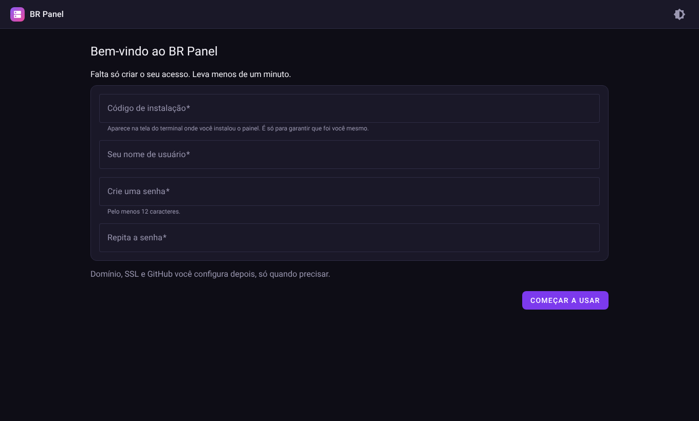

Nas visitas seguintes, a entrada é pela tela de login.

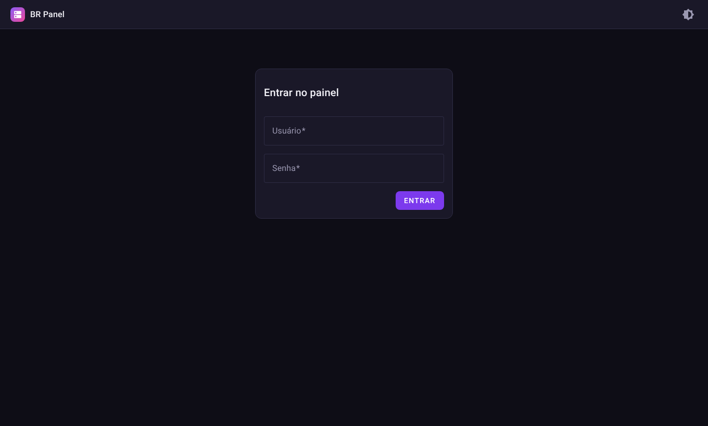

## Tela inicial

A tela inicial mostra o seu servidor como um mapa. Cada projeto e cada banco de dados é um bloco, e as setas indicam quem usa quem. Daí você abre qualquer item, vê se ele está funcionando e acompanha o uso de processador e de memória do servidor inteiro.

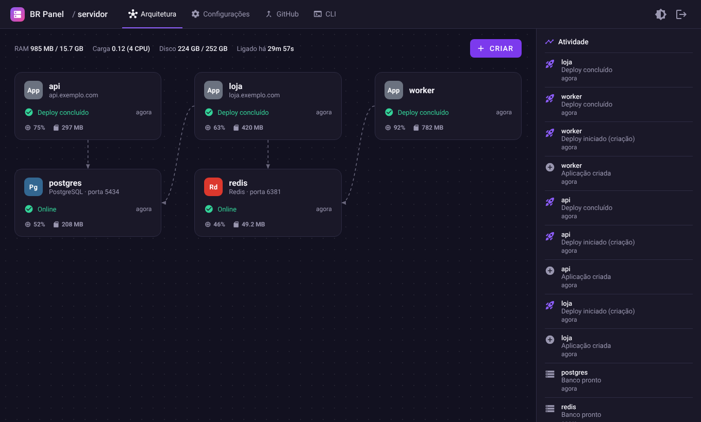

O menu Criar, no alto da tela, leva para as três coisas que você mais faz: publicar uma aplicação, instalar um programa pronto ou criar um banco de dados.

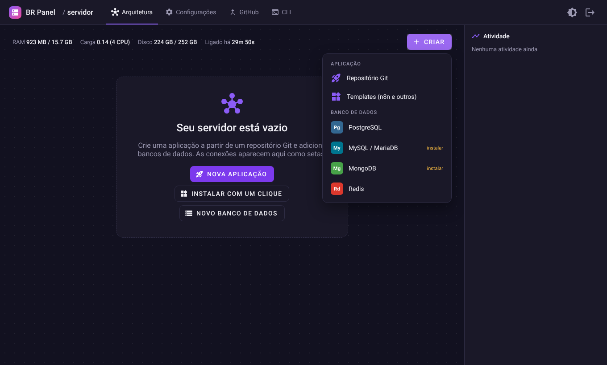

O painel tem tema escuro e tema claro, e troca com um clique.

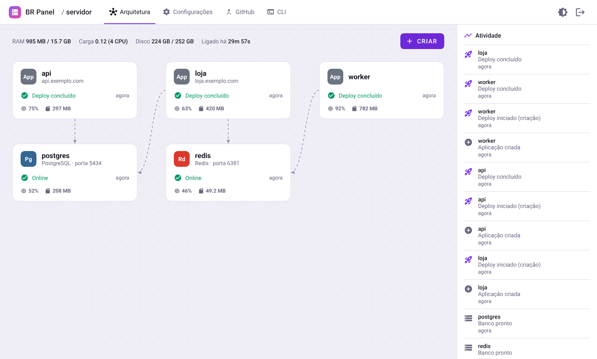

## Publicar um projeto

Você informa o endereço do repositório no GitHub. O painel baixa o projeto, descobre a linguagem em que ele foi escrito, escolhe uma porta livre e preenche os comandos necessários. Funciona com projetos feitos em Node.js, Go, Rust, Python, Ruby e PHP, e com sites estáticos. Se o seu projeto é diferente, você pode escrever os comandos à mão.

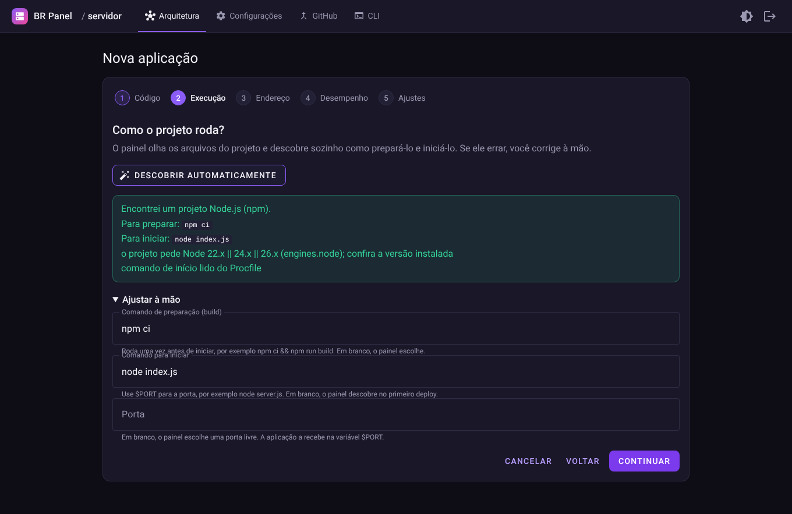

Se faltar algum programa no servidor, o painel avisa e, no caso do Node.js, instala para você.

Cada projeto tem a sua página: estado atual, histórico de publicações, variáveis de configuração, gráficos e registros.

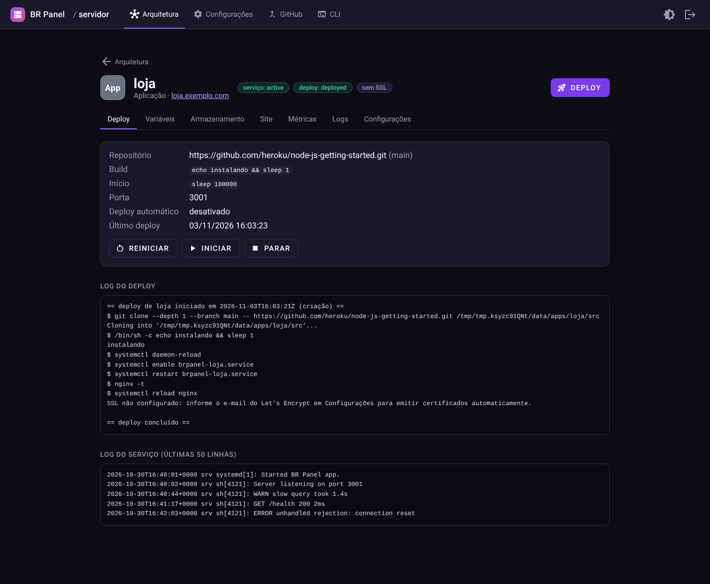

## Publicações mais rápidas

O painel guarda o que já baixou. Na segunda publicação de um projeto, só chegam as mudanças do código, e os pacotes que o projeto usa vêm de uma pasta de cache que todas as aplicações dividem. Se as dependências não mudaram desde a última vez, o painel nem as instala de novo.

Na tela de Configurações, o cartão Cache de builds mostra quanto espaço esse cache ocupa, com botões para apagar o que ninguém usa há 30 dias ou para esvaziar tudo. Se um projeto se comportar de um jeito estranho depois de uma atualização, o botão Refazer do zero, na página dele, apaga o código baixado e as dependências e reconstrói tudo. Os arquivos guardados em Armazenamento não são apagados.

## Endereço próprio e cadeado

Ao informar um domínio, o painel liga o endereço ao projeto e pede o certificado de segurança gratuito (Let's Encrypt). Ele renova o certificado sozinho. Se o seu domínio está na Cloudflare, o painel também cria a entrada de DNS por você, para não precisar mexer em outro site.

Cada projeto aceita endereços extras, redirecionamentos (por exemplo, `www` para o endereço principal), senha para entrar no site, página de manutenção e limites de tamanho de envio de arquivos.

## Atualização automática pelo GitHub

Com o aplicativo do GitHub conectado, cada vez que você envia uma mudança ao repositório o painel publica a nova versão. A tela do GitHub explica cada passo, e a conexão pode ser criada com poucos cliques.

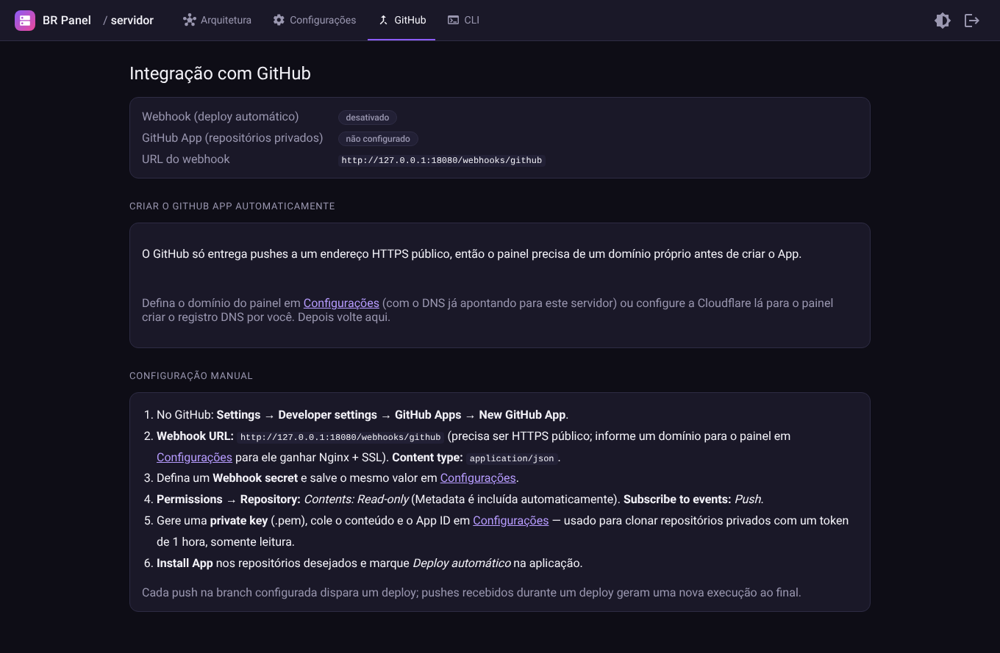

Repositórios privados também funcionam. O painel só recebe uma permissão de leitura, que expira em uma hora.

## Programas prontos

Em Templates você instala programas conhecidos sem configurar nada:

- n8n, para automatizar tarefas entre sistemas;
- Uptime Kuma, que avisa quando um site sai do ar;
- Gitea, para guardar os seus próprios repositórios de código.

Cada um recebe senhas geradas na hora, um lugar protegido para guardar os dados e o endereço certo. Para atualizar, basta publicar de novo.

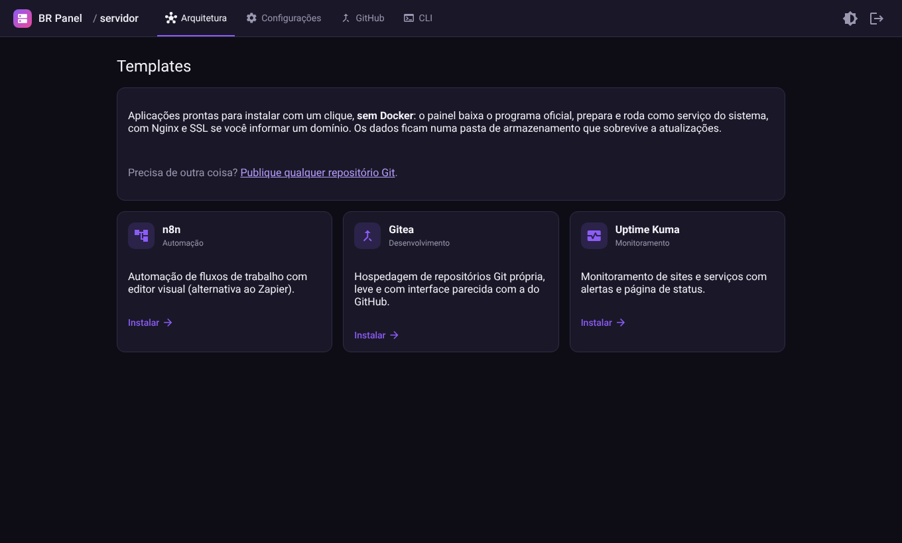

## Bancos de dados

O painel cria bancos PostgreSQL, MySQL (ou MariaDB), MongoDB e Redis. Cada banco é separado dos outros e só aceita conexões do próprio servidor, a menos que você libere acesso externo.

- A senha e os dados de conexão aparecem prontos para copiar.
- Você pode olhar as tabelas e os dados direto na tela.
- Os projetos usam o banco por uma variável. Se você trocar a senha, basta publicar o projeto de novo.
- As cópias de segurança são manuais ou agendadas, com opção de baixar e de restaurar.

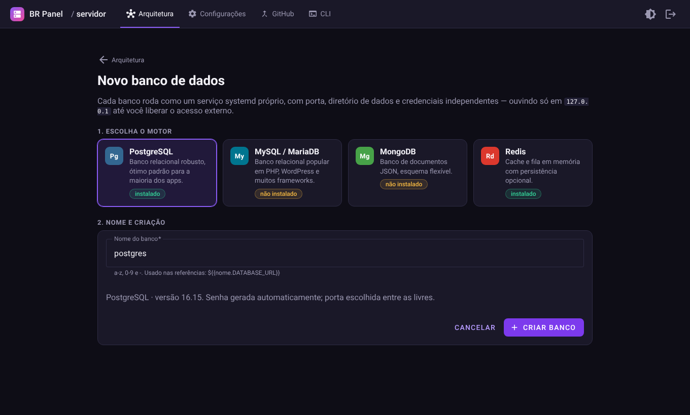

## Gráficos de uso

O painel mede o processador e a memória de cada projeto a cada 15 segundos e guarda 24 horas. A página do projeto mostra os gráficos de 1, 6 e 24 horas. Você vê rápido qual projeto está pesado e em que horário.

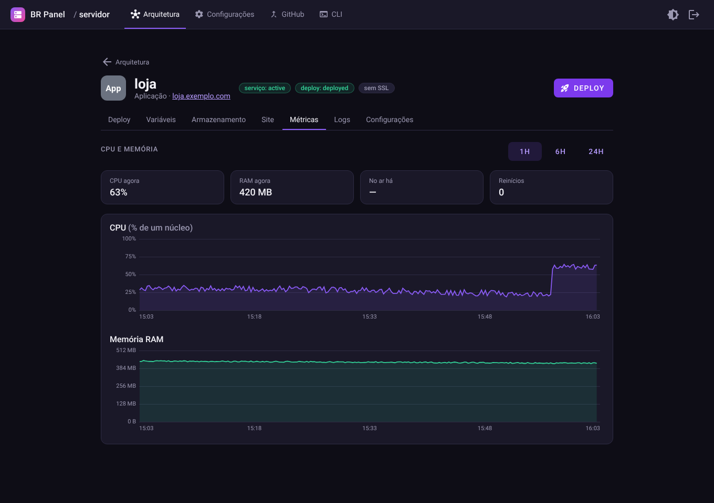

Os registros do sistema também ficam numa tela só: dá para filtrar por texto, ver erros e avisos em destaque, acompanhar ao vivo e baixar o arquivo.

## Mais visitantes, sem tirar o site do ar

Em Desempenho, você escolhe quantas cópias do projeto devem rodar (de 1 a 16). O painel reparte as visitas entre elas e, a cada publicação, troca uma cópia por vez, então o site continua no ar.

Dá para ligar o ajuste automático: você define um mínimo, um máximo e quanto de uso considera normal. Se o movimento sobe, o painel liga mais cópias. Se o movimento cai, ele desliga o que sobrou, devagar, para não correr o risco de faltar. Também é possível limitar a memória e o processador de cada projeto e o número de pedidos por visitante.

## Arquivos que não se perdem

A cada publicação, o código do projeto é trocado por inteiro. Por isso existe a aba Armazenamento, para o que precisa ficar: fotos enviadas pelos usuários, arquivos de dados, configurações. Você escolhe a pasta, e ela passa a ser a mesma em todas as publicações. Há cópias de segurança manuais ou agendadas, com até sete guardadas por pasta.

## Controle por linha de comando e por inteligência artificial

O painel também responde a comandos escritos, como `brpanel apps list`. Dá para controlar um servidor de longe, a partir do notebook, do celular (no Termux, no Android) ou de um computador com Windows ou macOS. A página CLI do painel lista todos os comandos, com exemplos.

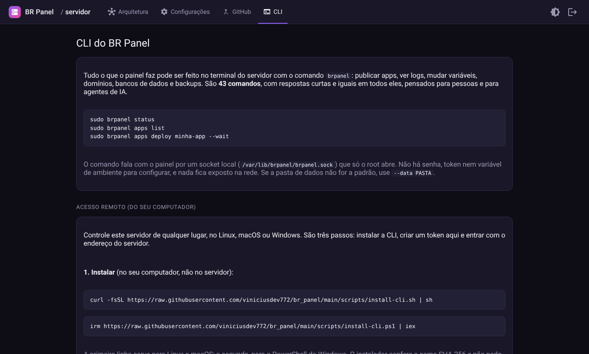

As respostas são escritas de forma simples, com dicas do próximo passo, e funcionam bem com assistentes de inteligência artificial. Você pode copiar o guia da página e colar no seu assistente, para ele cuidar do servidor por você. Comandos que apagam dados sempre pedem confirmação.

## No celular

Todas as telas se ajustam ao celular.

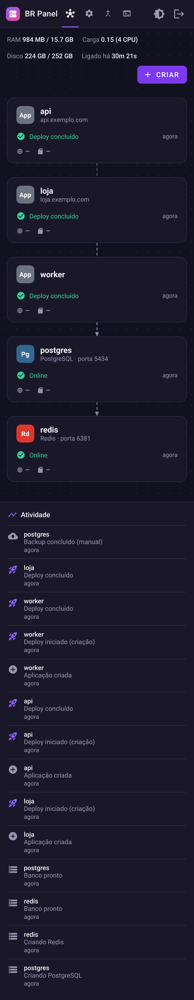

## Configurações

Em Configurações você ajusta o domínio do painel, o e-mail usado para os certificados, a conexão com a Cloudflare e a versão do Node.js. Tudo fica guardado no próprio painel, sem arquivos de configuração para editar.

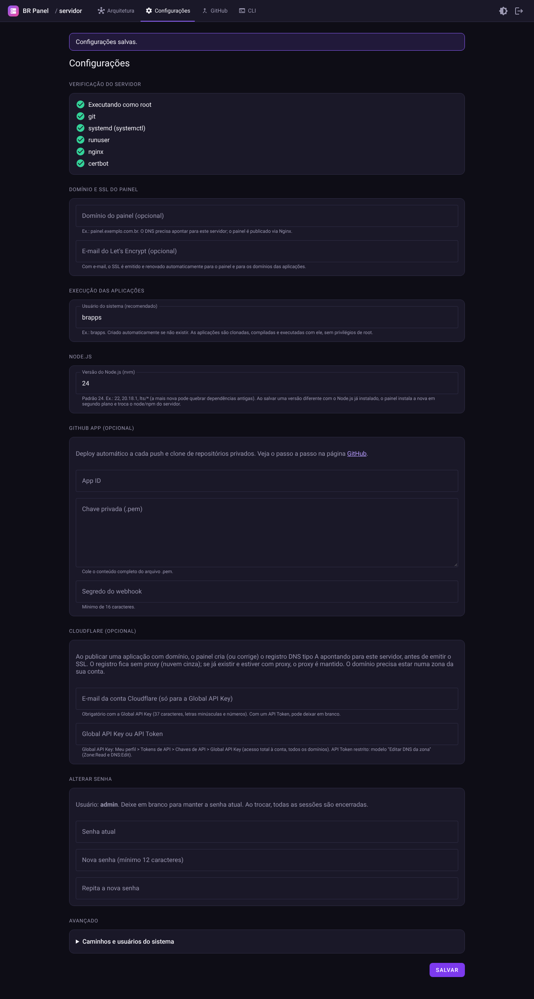

## Segurança, em resumo

- Senha forte e bloqueio de quem erra a senha várias vezes.
- Todas as ações que mudam algo exigem uma confirmação interna, que impede que outro site faça pedidos em seu nome.
- Senhas e chaves nunca aparecem em registros nem nos comandos.
- As aplicações rodam com um usuário comum, sem poderes de administrador.

Os detalhes para quem quer entender o funcionamento por dentro estão em [Referência técnica](referencia-tecnica.md).
